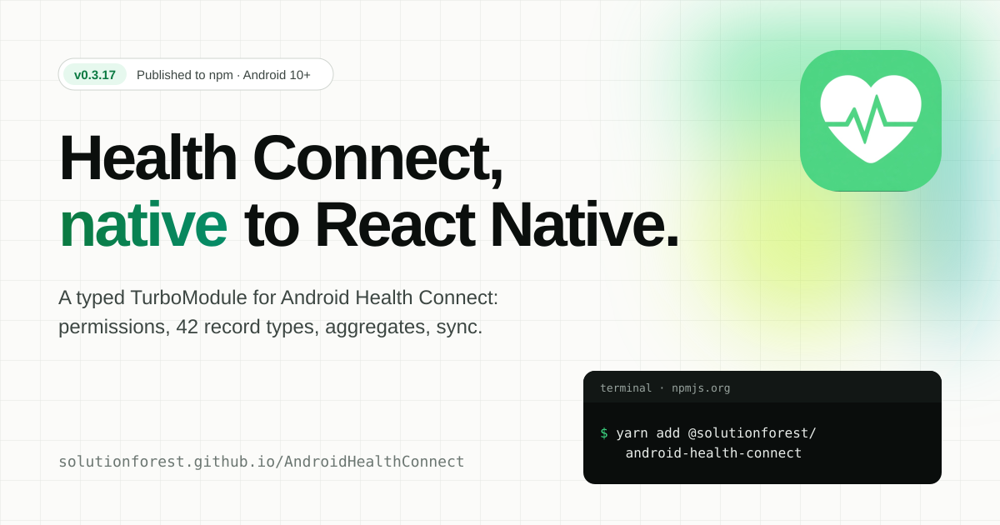

<p align="center">
  
</p>

<h1 align="center">android-health-connect — Android Health Connect for React Native</h1>

<p align="center"><strong>Read and write steps, heart rate, sleep, workouts and 42 Health Connect record types from React Native — TypeScript-first TurboModule with an Expo config plugin.</strong></p>

<p align="center">
  <a href="https://github.com/solutionforest/AndroidHealthConnect/actions/workflows/ci.yml"></a>
  <a href="https://github.com/solutionforest/AndroidHealthConnect/releases"></a>
  <a href="./LICENSE"></a>
  <a href="https://developer.android.com/health-and-fitness/health-connect"></a>
  <a href="https://reactnative.dev/"></a>
  
  
  
</p>

**android-health-connect** is a React Native library (TurboModule, TypeScript, Expo-compatible) for integrating with [Android Health Connect](https://developer.android.com/health-and-fitness/health-connect) — the unified health & fitness data platform on Android 10+ (API 29+).

> **Android only.** This library has no iOS implementation.

**Docs site:** [solutionforest.github.io/AndroidHealthConnect](https://solutionforest.github.io/AndroidHealthConnect/) ([guides](https://solutionforest.github.io/AndroidHealthConnect/guides.html) · [record types](https://solutionforest.github.io/AndroidHealthConnect/records.html)) · **AI agent skill:** [skills.md](./skills.md) ([install it](#ai-agent-skill-skillsmd))

**Quality** (since 0.3.6): max-strict TypeScript · type-aware ESLint · Jest coverage gates · Kotlin `allWarningsAsErrors` · CI fails on drop. Security model: [SECURITY.md](./SECURITY.md).

## Support

| Area | Status | Notes |
|---|---|---|
| Android | ✅ Supported | API 29+ / Android 10+ |
| iOS | ❌ Not supported | No native iOS implementation |
| React Native New Architecture | ✅ Required | TurboModules / RN 0.84+ |
| Expo | ✅ Supported | SDK 50+ via config plugin |
| Bare React Native | ✅ Supported | Manual manifest + rationale setup |
| Health Connect permissions | ✅ Supported | Request / check / revoke |
| Read / write / delete records | ✅ Supported | See [Supported record types](#supported-record-types) |
| Aggregate / bucket queries | ✅ Supported | `aggregateRecord`, `aggregateGroupByDuration`, `aggregateGroupByPeriod` |
| Exercise routes | ✅ Supported | Write on `ExerciseSession`; read `DATA` / `NO_DATA` / `CONSENT_REQUIRED` + `requestExerciseRoute` |
| Changelog sync | ✅ Supported | `getChangesToken` / `getChanges` (upsert + delete pages; ~30-day tokens) |
| Planned exercise | ✅ Supported | `PlannedExerciseSession` when `plannedExercise` feature is available |
| Library upgrade reminder | ✅ Supported | `checkLibraryUpdate()` + weekly CI (HC SDK / release drift → issue) |
| CI / quality gates | ✅ GitHub-hosted | lint, typecheck, Jest + Kotlin unit tests, library + Android build, audit |
| Distribution | ✅ npmjs.org + GitHub Releases | Primary: [npmjs](https://www.npmjs.com/package/@solutionforest/android-health-connect). Mirror: GitHub Packages. Release `.tgz` has SBOM + attestations |
| CodeQL | ✅ Supported | On `main` PRs/pushes + weekly schedule |

## Requirements

This library is a **TurboModule** — it needs **React Native 0.84+** (New Architecture).  
**RN 0.6x / 0.7x / &lt;0.84 are not supported** on either release line.

Pick a line by Android toolchain (HC SDK / AGP), not by RN major:

| Package | RN | Node | `connect-client` | Min AGP | compileSdk | Branch / tag |
|---|---|---|---|---|---|---|
| **[`0.3.15`](https://github.com/solutionforest/AndroidHealthConnect/releases/tag/v0.3.15)** (default) | **≥0.84** | **≥22.22** | **`1.2.0-alpha06`** | **9.1.0** | **37** | `main` |
| **[`0.2.4`](https://github.com/solutionforest/AndroidHealthConnect/releases/tag/v0.2.4)** (maintenance) | **≥0.84** | **≥22.11** | **`1.1.0`** (stable) | **8.9.1** | **36** | [`release/0.2.x`](https://github.com/solutionforest/AndroidHealthConnect/tree/release/0.2.x) |

```sh
# npmjs.org (default — no .npmrc needed)
yarn add @solutionforest/android-health-connect@0.3.15   # AGP 9.1+ / compileSdk 37
yarn add @solutionforest/android-health-connect@0.2.4   # AGP 8.9.1+ / compileSdk 36 (dist-tag release-0.2)
```

### What `0.3.15` (this branch) needs in your host app

| Requirement | Value for `0.3.15` |
|---|---|
| Install | `@solutionforest/android-health-connect` from **npmjs.org** |
| Health Connect Jetpack SDK | [`connect-client:1.2.0-alpha06`](https://developer.android.com/jetpack/androidx/releases/health-connect) |
| Android Gradle Plugin | **9.1.1** (min **9.1.0**) |
| Gradle | **9.3.1+** (required by AGP 9.1) |
| compileSdk | **37** |
| Android OS | 10 (API 29)+ |
| Health Connect app | Required on Android 9–13; built-in on Android 14+ |
| React Native | **≥0.84** (New Architecture / TurboModules) — not 0.6x / 0.7x |
| Node.js | ≥22.22 |
| Expo (optional) | SDK 50+ |

### Health Connect SDK changelog (context)

Official notes ([full changelog](https://developer.android.com/jetpack/androidx/releases/health-connect)):

| SDK version | Date | What changed |
|---|---|---|
| **1.2.0-alpha06** | 2026-08-26 | Updated Health Connect **release and dev signing certificates** |
| **1.2.0-alpha05** | 2026-08-12 | Jetpack SDK `minSdk` → API 24; secured intents on Android &lt; 14; signature validation fix |
| **1.2.0-alpha04** | 2026-04-22 | **Matchmaking APIs** |
| **1.2.0-alpha03** | 2026-03-25 | Richer exercise fields; change-log `pageSize`; activity intensity |
| **1.2.0-alpha02** | 2025-10-08 | Additional device type enums |
| **1.2.0-alpha01** | 2025-07-30 | Skin temperature / mindfulness compat; activity intensity (Android 14+) |
| **1.1.0** (stable) | 2025-10-08 | First stable `connect-client` |

JS API: [42 record types](#supported-record-types), feature checks, Matchmaking, PHR. Feature-gated types need `getFeatureStatus(...) === 'available'`.

## Installation

Same scoped name on **both** registries: `@solutionforest/android-health-connect`. Full dual-registry guide: [docs site → Install](https://solutionforest.github.io/AndroidHealthConnect/install.html).

| Registry | Role | How |
|---|---|---|
| **[npmjs.org](https://www.npmjs.com/package/@solutionforest/android-health-connect)** | **Primary** | `yarn add` / `npm i` — no `.npmrc` |
| **[GitHub Packages](https://github.com/orgs/solutionforest/packages?repo_name=AndroidHealthConnect)** | **Mirror** + Release `.tgz` (SBOM / attestations) | Scope `@solutionforest` → `npm.pkg.github.com` + PAT (`read:packages`) |

### npmjs.org (primary)

```sh
# Default (0.3.x): connect-client 1.2.0-alpha06 — needs AGP 9.1+ / compileSdk 37
yarn add @solutionforest/android-health-connect@0.3.15
# or
npm install @solutionforest/android-health-connect@0.3.15

# Maintenance (0.2.x): connect-client 1.1.0 stable — AGP 8.9.1+ / compileSdk 36
yarn add @solutionforest/android-health-connect@release-0.2
```

### GitHub Packages (mirror)

```ini
# .npmrc
@solutionforest:registry=https://npm.pkg.github.com
//npm.pkg.github.com/:_authToken=YOUR_GITHUB_PAT
```

```sh
yarn add @solutionforest/android-health-connect@0.3.15
```

Use a classic PAT with `read:packages` (SSO-authorize for `solutionforest` if required).

Alternatives: install from git (`solutionforest/AndroidHealthConnect#v0.3.15`) or download the Release `.tgz`.

Pushing a `v*` tag runs the **Release** workflow: packs `.tgz`, uploads to the GitHub Release, publishes to **npmjs.org** via Trusted Publishing (OIDC), and mirrors to GitHub Packages.

### AI agent skill (`skills.md`)

The package ships [`skills.md`](./skills.md): an agent skill that tells AI coding agents (Cursor, Claude Code, Codex, …) how to use this library correctly. It covers which version line to pick, the hard constraints (Android only, RN 0.84+ New Architecture), the availability → permissions → read order, and resume polling. Install it into your app repo so your agent follows it.

Copy it from the installed package, so the skill always matches the version you installed:

```sh
# Cursor
mkdir -p .cursor/skills/android-health-connect
cp node_modules/@solutionforest/android-health-connect/skills.md \
  .cursor/skills/android-health-connect/SKILL.md

# Claude Code
mkdir -p .claude/skills/android-health-connect
cp node_modules/@solutionforest/android-health-connect/skills.md \
  .claude/skills/android-health-connect/SKILL.md

# Other agents (Codex, Gemini CLI, … — any tool that reads .agents/skills)
mkdir -p .agents/skills/android-health-connect
cp node_modules/@solutionforest/android-health-connect/skills.md \
  .agents/skills/android-health-connect/SKILL.md
```

Or download the latest from the docs site, before the package is installed:

```sh
curl -fsSL --create-dirs \
  -o .cursor/skills/android-health-connect/SKILL.md \
  https://solutionforest.github.io/AndroidHealthConnect/skills.md
```

Or paste this prompt into your agent:

> Install the android-health-connect agent skill: download https://solutionforest.github.io/AndroidHealthConnect/skills.md and save it as `SKILL.md` in this project's skills folder (`.cursor/skills/android-health-connect/` for Cursor, `.claude/skills/android-health-connect/` for Claude Code, otherwise `.agents/skills/android-health-connect/`). Then follow it whenever you work with `@solutionforest/android-health-connect`.

Commit the skill folder so the whole team's agents get it. Re-copy after upgrading the package.

### Expo setup

If you are using **Expo** (SDK 50+), add the library's config plugin to your `app.json` or `app.config.js`. The plugin automatically handles adding the required Health Connect intent filters to your Android manifest.

```json
{
  "expo": {
    "plugins": [
      [
        "@solutionforest/android-health-connect",
        {
          "permissions": [
            "android.permission.health.READ_STEPS",
            "android.permission.health.WRITE_STEPS",
            "android.permission.health.READ_HEART_RATE"
          ]
        }
      ]
    ]
  }
}
```

If you omit `permissions` (or pass `[]`), the plugin still adds the required
intent-filters but **does not declare any health permissions** — list only what
your app needs:

```json
{
  "expo": {
    "plugins": ["@solutionforest/android-health-connect"]
  }
}
```

After updating `app.json`, run `npx expo prebuild` to regenerate the native Android project.

### Android setup (bare React Native)

#### 1. Declare permissions in your app's `AndroidManifest.xml`

Health Connect requires every permission your app uses to be declared in the **host app's** manifest (the library manifest is merged automatically, but you must also add them to your app):

```xml
<manifest ...>
  <!-- Declare only the permissions your app actually needs -->
  <uses-permission android:name="android.permission.health.READ_STEPS" />
  <uses-permission android:name="android.permission.health.WRITE_STEPS" />
  <uses-permission android:name="android.permission.health.READ_HEART_RATE" />
  <!-- ... other permissions ... -->

  <application ...>
    <activity android:name=".MainActivity" ...>
      <!-- Required for Health Connect permission rationale (Android ≤ 13) -->
      <intent-filter>
        <action android:name="androidx.health.ACTION_SHOW_PERMISSIONS_RATIONALE" />
      </intent-filter>

      <!-- Required for Health Connect permission UI (Android 14+) -->
      <intent-filter>
        <action android:name="android.intent.action.VIEW_PERMISSION_USAGE" />
        <category android:name="android.intent.category.HEALTH_PERMISSIONS" />
      </intent-filter>
    </activity>
  </application>
</manifest>
```

#### 2. Add Health Connect permission rationale (required)

Create `res/values/health_permissions.xml`:

```xml
<resources>
  <string name="health_permissions_rationale">
    This app uses Health Connect to read and write your health data.
  </string>
</resources>
```

## Usage

Runnable host demo (buttons for the flows below): [`example/`](./example/) —
see [`example/README.md`](./example/README.md) for a first-run checklist.

### Check availability

```ts
import {
  ensureAvailable,
  isHealthConnectAvailable,
  getHealthConnectAvailability,
  openHealthConnectApp,
} from '@solutionforest/android-health-connect';

// Quick gate — opens Play Store / Settings when notInstalled (default):
const status = await ensureAvailable();
if (status !== 'available') {
  // notInstalled (store opened) | notSupported (hide HC UI)
}

// Or check without side effects:
const availability = await isHealthConnectAvailable();
// 'available' | 'notInstalled' | 'notSupported'
if (availability === 'notInstalled') {
  openHealthConnectApp(); // Play Store market:// (or Settings on Android 14+)
}

// Prefer details when diagnosing install vs built-in vs China / HMS:
const info = await getHealthConnectAvailability();
// info.provider: 'framework' (Android 14+) | 'apk' (9–13) | 'none'
// info.sdkStatus: 1 = UNAVAILABLE, 2 = PROVIDER_UPDATE_REQUIRED, 3 = AVAILABLE
// info.googlePlayServicesAvailable / playStoreAvailable / advice
```

### Device & region notes

| Situation | What happens | What to do |
|---|---|---|
| **Android 14+** | Health Connect is **built into** the system | Use Settings / `openHealthConnectSettings()` |
| **Android 9–13** | Health Connect is a **Play Store APK** | `openHealthConnectApp()` → Play Store install/update |
| **`sdkStatus === 3`** | **Available** (not “version too old”) | Safe to call APIs |
| **Mainland China / no GMS** | HC requires Google Play services; CN Play Storefront does not list HC | `status: 'notSupported'`; hide HC UI — cannot install via Play |
| **Huawei / HMS without GMS** | Same as no GMS | Unsupported for Health Connect |
| **Samsung / Xiaomi data gaps** | Vendor apps must **write into** HC; library only reads HC | Enable Health Connect sharing in the vendor app |

Official availability: [Check Health Connect availability](https://developer.android.com/health-and-fitness/health-connect/availability).

### Request permissions

```ts
import {
  requestPermissions,
  Permission,
} from '@solutionforest/android-health-connect';

const needed = [
  Permission.READ_STEPS,
  Permission.WRITE_STEPS,
  Permission.READ_HEART_RATE,
];

const granted = await requestPermissions(needed);
console.log('Granted:', granted);

// Quick checks (no dialog):
import {
  hasPermissions,
  missingPermissions,
  ensurePermissions,
} from '@solutionforest/android-health-connect';

if (!(await hasPermissions(needed))) {
  const missing = await missingPermissions(needed);
  console.log('Still missing:', missing);
}

// Or request any missing in one shot:
const ensured = await ensurePermissions(needed);
if (!ensured.allGranted) {
  console.log('User denied:', ensured.missing);
}
```

**History / background (optional special permissions):** by default HC only lets apps
read ~30 days before first grant, and only while foregrounded. Declare in the host
manifest, gate on feature status, then request:

```ts
import {
  getFeatureStatus,
  requestPermissions,
  Permission,
} from '@solutionforest/android-health-connect';

import type { HealthPermission } from '@solutionforest/android-health-connect';

const extra: HealthPermission[] = [];
if ((await getFeatureStatus('readHealthDataHistory')) === 'available') {
  extra.push(Permission.READ_HEALTH_DATA_HISTORY);
}
if ((await getFeatureStatus('readHealthDataInBackground')) === 'available') {
  extra.push(Permission.READ_HEALTH_DATA_IN_BACKGROUND);
}
await requestPermissions([Permission.READ_STEPS, ...extra]);
```

```xml
<uses-permission android:name="android.permission.health.READ_HEALTH_DATA_HISTORY" />
<uses-permission android:name="android.permission.health.READ_HEALTH_DATA_IN_BACKGROUND" />
```

### Read records

```ts
import { readSteps, readHeartRate } from '@solutionforest/android-health-connect';

const { records, pageToken } = await readSteps({
  timeRangeFilter: {
    startTime: '2024-01-01T00:00:00Z',
    endTime:   '2024-01-08T00:00:00Z',
  },
  ascendingOrder: true,
  pageSize: 100,
});

records.forEach(r => console.log(r.count, r.startTime));
```

Using the generic helper:

```ts
import { readRecords } from '@solutionforest/android-health-connect';
import type { WeightRecord } from '@solutionforest/android-health-connect';

const { records } = await readRecords<WeightRecord>('Weight', {
  timeRangeFilter: { startTime: '...', endTime: '...' },
});
```

### Write records

Prefer `RecordType.*` over hand-typed `'Steps'` strings (same idea as `Permission.*`).
Times use a Carbon-style fluent Instant — `now().subHours(1)` reads like English:

```ts
import {
  writeRecords,
  RecordType,
  now,
  timeRangeLastHours,
} from '@solutionforest/android-health-connect';

const { startTime, endTime } = timeRangeLastHours(1);
// or: now().subHours(1).until(now())

const { recordIdsList } = await writeRecords([
  {
    recordType: RecordType.STEPS,
    count: 8000,
    startTime,
    endTime,
  },
  {
    recordType: RecordType.WEIGHT,
    weight: 75.5, // kg
    time: now().subMinutes(30).toISOString(),
  },
]);
```

### Update records

`updateRecords` edits existing rows. Pass the same shape as write, plus
`metadata.id` from a prior read (required). Optional `recordingMethod` / `device`
round-trip when present on the read record.

```ts
import {
  readSteps,
  updateRecords,
  RecordingMethod,
} from '@solutionforest/android-health-connect';

const { records } = await readSteps({
  timeRangeFilter: { startTime: '...', endTime: '...' },
});
const existing = records[0];
if (!existing?.metadata?.id) throw new Error('nothing to update');

await updateRecords([
  {
    ...existing,
    count: existing.count + 100,
    metadata: {
      ...existing.metadata,
      id: existing.metadata.id,
      recordingMethod: existing.metadata.recordingMethod ?? RecordingMethod.MANUAL_ENTRY,
    },
  },
]);
```

### Exercise routes

Requires `WRITE_EXERCISE_ROUTE` to insert a route with a session, and
`READ_EXERCISE_ROUTES` to read routes written by other apps. Omit optional
altitude / accuracy fields instead of sending empty objects.

```ts
import {
  writeRecords,
  readExerciseSessions,
  requestExerciseRoute,
  getFeatureStatus,
  ExerciseType,
} from '@solutionforest/android-health-connect';

await writeRecords([
  {
    recordType: 'ExerciseSession',
    exerciseType: ExerciseType.RUNNING,
    startTime: '2024-01-01T08:00:00Z',
    endTime: '2024-01-01T09:00:00Z',
    exerciseRoute: {
      route: [
        { time: '2024-01-01T08:00:00Z', latitude: 51.5, longitude: -0.12, altitude: 19 },
        { time: '2024-01-01T08:30:00Z', latitude: 51.51, longitude: -0.11 },
      ],
    },
  },
]);

// Optional 1.2 fields — gate on FEATURE_EXERCISE_SESSION_IMPROVEMENTS:
if ((await getFeatureStatus('exerciseSessionImprovements')) === 'available') {
  await writeRecords([
    {
      recordType: 'ExerciseSession',
      exerciseType: ExerciseType.RUNNING,
      startTime: '2024-01-01T08:00:00Z',
      endTime: '2024-01-01T09:00:00Z',
      rateOfPerceivedExertion: 6.5,
      // plannedExerciseSessionId: '<id from PlannedExerciseSession write>',
    },
  ]);
}

const { records } = await readExerciseSessions({ /* timeRangeFilter … */ });
for (const session of records) {
  const route = session.exerciseRoute;
  if (!route || route.type === 'NO_DATA') continue;
  if (route.type === 'CONSENT_REQUIRED') {
    const granted = await requestExerciseRoute(session.metadata?.id ?? '');
    console.log(granted?.route);
  } else {
    console.log(route.route); // LengthResult altitude / accuracy when present
  }
}
```

### Planned exercise (training plans)

Requires `getFeatureStatus('plannedExercise') === 'available'` and
`READ_PLANNED_EXERCISE` / `WRITE_PLANNED_EXERCISE`.

```ts
import {
  requestPermissions,
  writeRecords,
  readPlannedExerciseSessions,
  ExerciseType,
  ExerciseSegmentType,
  ExercisePhase,
  Permission,
} from '@solutionforest/android-health-connect';

await requestPermissions([
  Permission.READ_PLANNED_EXERCISE,
  Permission.WRITE_PLANNED_EXERCISE,
]);

await writeRecords([
  {
    recordType: 'PlannedExerciseSession',
    exerciseType: ExerciseType.RUNNING,
    startTime: '2024-01-03T08:00:00Z',
    endTime: '2024-01-03T09:30:00Z',
    title: 'Lake run',
    blocks: [
      {
        repetitions: 1,
        description: 'Three laps',
        steps: [
          {
            exerciseType: ExerciseSegmentType.RUNNING,
            exercisePhase: ExercisePhase.ACTIVE,
            completionGoal: { type: 'Repetitions', repetitions: 3 },
            performanceTargets: [
              { type: 'HeartRate', minHeartRate: 90, maxHeartRate: 110 },
            ],
          },
        ],
      },
    ],
  },
]);

await readPlannedExerciseSessions({ /* timeRangeFilter … */ });
```

### Time ranges & waiting for data (resume → often `0` first)

Health Connect has **no push observer**. On a real phone, after you **resume /
re-open the app**, the first read or aggregate is often `0` / empty — vendor apps
(Samsung Health, Fitbit, …) may still be writing into HC. Google’s guidance: sync
when the app becomes foreground, and optionally poll while it stays open.

`useForegroundPoll` does this for you: it polls on mount and on every resume,
aborts the in-flight poll when the app backgrounds (so a stale result never
overwrites a newer one), and keeps the last value on timeout.

```tsx
import {
  aggregateRecord,
  timeRangeToday,
  useForegroundPoll,
} from '@solutionforest/android-health-connect';

const stepsOf = (r: { metrics: Record<string, unknown> }) => {
  const n = r.metrics['COUNT_TOTAL'];
  return typeof n === 'number' ? n : 0;
};

function TodaySteps({ granted }: { granted: boolean }) {
  const { value, satisfied, loading, error, refresh } = useForegroundPoll(
    () =>
      aggregateRecord({ recordType: 'Steps', timeRangeFilter: timeRangeToday() }),
    {
      // "> 0" only when you expect activity; a real 0-step day times out.
      ready: (r) => stepsOf(r) > 0,
      timeoutMs: 20_000,
      intervalMs: 1_000,
      enabled: granted, // wait until permissions are granted
    }
  );

  if (error) return <Text onPress={refresh}>Couldn’t read steps. Tap to retry</Text>;
  return (
    <Text onPress={refresh}>
      {value ? stepsOf(value) : '–'} steps
      {loading ? ' · syncing…' : !satisfied && value ? ' · no new data yet' : ''}
    </Text>
  );
}
```

Outside React, use `pollOnForeground(fetch, { ready, onResult, onError })`;
it returns `{ refresh, stop }`. For a single one-off wait, use
`pollUntil` (soft) or `waitUntil` (throws `WaitTimeoutError`).

```ts
import {
  timeRangeLastDays,
  waitForRecords,
  readAllRecords,
} from '@solutionforest/android-health-connect';

// After your own writeRecords — wait until the row is readable:
await waitForRecords({
  recordType: 'Steps',
  timeRangeFilter: timeRangeLastDays(1),
  minCount: 1,
  timeoutMs: 15_000,
});

const all = await readAllRecords('Steps', {
  timeRangeFilter: timeRangeLastDays(7),
});
```

### Aggregates

`aggregateRecord` uses Instant time ranges. Prefer
`aggregateGroupByDuration` for fixed buckets (also Instant — avoids Android 14+
UTC wall-clock shift). Use `aggregateGroupByPeriod` for calendar days/weeks
(LocalDateTime in the device zone).

```ts
import {
  aggregateRecord,
  aggregateGroupByDuration,
  timeRangeLastDays,
} from '@solutionforest/android-health-connect';

const total = await aggregateRecord({
  recordType: 'Steps',
  timeRangeFilter: timeRangeLastDays(7),
});
console.log(total.metrics['COUNT_TOTAL']); // number | null

const hourly = await aggregateGroupByDuration({
  recordType: 'Steps',
  timeRangeFilter: {
    startTime: '2024-01-01T00:00:00Z',
    endTime: '2024-01-02T00:00:00Z',
  },
  timeRangeSlicer: { unit: 'hours', value: 1 },
});
hourly.forEach((row) => {
  console.log(row.startTime, row.result.metrics['COUNT_TOTAL']);
});
```

### Delete records

```ts
import { deleteRecordsByTime, deleteRecordsById } from '@solutionforest/android-health-connect';

// By time range
await deleteRecordsByTime('Steps', '2024-01-01T00:00:00Z', '2024-01-02T00:00:00Z');

// By ID
await deleteRecordsById('Steps', ['record-id-1', 'record-id-2']);
```

### Changelog sync

Tokens expire after ~30 days. Prefer **one record type per token**. Loop while
`hasMore`; if `changesTokenExpired`, backfill with `readRecords` then mint a new
token. Optional `pageSize` (1–5000) is a soft hint.

```ts
import {
  getChangesToken,
  pullChanges,
} from '@solutionforest/android-health-connect';

let token = await getChangesToken({ recordTypes: ['Steps'] });
const batch = await pullChanges(token, { pageSize: 500 });
if (batch.changesTokenExpired) {
  // backfill with readRecords, then mint a fresh token
  token = await getChangesToken({ recordTypes: ['Steps'] });
} else {
  for (const { record } of batch.upsertionChanges) {
    console.log('upsert', record.recordType, record.metadata?.id);
  }
  for (const { recordId } of batch.deletionChanges) {
    console.log('delete', recordId);
  }
  token = batch.nextChangesToken; // persist for next sync
}
```

## Supported record types

> The 19 parity-batch types marked below are unit-tested but
> **⚠️ not fully tested on a real device yet**.

| Record type | Read | Write | Notes |
|---|---|---|---|
| `Steps` | ✅ | ✅ | |
| `HeartRate` | ✅ | ✅ | |
| `SleepSession` | ✅ | ✅ | |
| `ActiveCaloriesBurned` | ✅ | ✅ | |
| `TotalCaloriesBurned` | ✅ | ✅ | |
| `Distance` | ✅ | ✅ | |
| `Weight` | ✅ | ✅ | |
| `Height` | ✅ | ✅ | |
| `BloodPressure` | ✅ | ✅ | |
| `BloodGlucose` | ✅ | ✅ | |
| `OxygenSaturation` | ✅ | ✅ | |
| `BodyTemperature` | ✅ | ✅ | |
| `BodyFat` | ✅ | ✅ | |
| `Hydration` | ✅ | ✅ | |
| `ExerciseSession` | ✅ | ✅ | Optional `exerciseRoute`; read returns `DATA` / `NO_DATA` / `CONSENT_REQUIRED`; optional RPE / `plannedExerciseSessionId` when `exerciseSessionImprovements` |
| `PlannedExerciseSession` | ✅ | ✅ | Requires `getFeatureStatus('plannedExercise')`; blocks / steps / goals / targets |
| `RestingHeartRate` | ✅ | ✅ | |
| `RespiratoryRate` | ✅ | ✅ | |
| `FloorsClimbed` | ✅ | ✅ | |
| `ElevationGained` | ✅ | ✅ | |
| `MindfulnessSession` | ✅ | ✅ | Requires `getFeatureStatus('mindfulnessSession')` |
| `SkinTemperature` | ✅ | ✅ | Requires `getFeatureStatus('skinTemperature')` |
| `ActivityIntensity` | ✅ | ✅ | Requires `getFeatureStatus('activityIntensity')` |
| `Nutrition` | ✅ | ✅ | ⚠️ Not fully tested on a real device yet |
| `Vo2Max` | ✅ | ✅ | ⚠️ Not fully tested on a real device yet |
| `Speed` | ✅ | ✅ | ⚠️ Not fully tested on a real device yet |
| `Power` | ✅ | ✅ | ⚠️ Not fully tested on a real device yet |
| `StepsCadence` | ✅ | ✅ | ⚠️ Not fully tested on a real device yet; uses steps permission |
| `CyclingPedalingCadence` | ✅ | ✅ | ⚠️ Not fully tested on a real device yet; uses exercise permission |
| `WheelchairPushes` | ✅ | ✅ | ⚠️ Not fully tested on a real device yet |
| `MenstruationFlow` | ✅ | ✅ | ⚠️ Not fully tested on a real device yet; shares menstruation permission |
| `MenstruationPeriod` | ✅ | ✅ | ⚠️ Not fully tested on a real device yet; shares menstruation permission |
| `OvulationTest` | ✅ | ✅ | ⚠️ Not fully tested on a real device yet |
| `CervicalMucus` | ✅ | ✅ | ⚠️ Not fully tested on a real device yet |
| `IntermenstrualBleeding` | ✅ | ✅ | ⚠️ Not fully tested on a real device yet |
| `SexualActivity` | ✅ | ✅ | ⚠️ Not fully tested on a real device yet |
| `BasalBodyTemperature` | ✅ | ✅ | ⚠️ Not fully tested on a real device yet |
| `LeanBodyMass` | ✅ | ✅ | ⚠️ Not fully tested on a real device yet |
| `BoneMass` | ✅ | ✅ | ⚠️ Not fully tested on a real device yet |
| `BodyWaterMass` | ✅ | ✅ | ⚠️ Not fully tested on a real device yet |
| `BasalMetabolicRate` | ✅ | ✅ | ⚠️ Not fully tested on a real device yet |
| `HeartRateVariabilityRmssd` | ✅ | ✅ | ⚠️ Not fully tested on a real device yet |

### Feature-gated APIs

```ts
import {
  getFeatureStatus,
  checkIfMatchmakingIsPossible,
  launchMatchmaking,
  createMedicalDataSource,
  upsertMedicalResources,
  readMedicalResources,
  MedicalResourceType,
} from '@solutionforest/android-health-connect';

// Feature availability (skin temperature, mindfulness, activity intensity, matchmaking, PHR, …)
const skinTemp = await getFeatureStatus('skinTemperature'); // 'available' | 'unavailable'

// Matchmaking (experimental) — discover apps/devices that can write data you can read
if ((await getFeatureStatus('matchmaking')) === 'available') {
  const { isMatchmakingPossible } = await checkIfMatchmakingIsPossible({
    recordTypes: ['Steps', 'HeartRate'],
  });
  if (isMatchmakingPossible) {
    await launchMatchmaking({ recordTypes: ['Steps', 'HeartRate'] });
  }
}

// Personal Health Record / medical (experimental) — FHIR MedicalDataSource + MedicalResource
if ((await getFeatureStatus('personalHealthRecord')) === 'available') {
  const source = await createMedicalDataSource({
    displayName: 'Clinic FHIR',
    fhirBaseUri: 'https://example.com/fhir/',
    fhirVersion: { major: 4, minor: 0, patch: 1 },
  });
  await upsertMedicalResources([
    {
      dataSourceId: source.id,
      fhirVersion: source.fhirVersion,
      data: JSON.stringify({ resourceType: 'AllergyIntolerance', id: '1', /* … */ }),
    },
  ]);
  const page = await readMedicalResources({
    medicalResourceType: MedicalResourceType.ALLERGIES_INTOLERANCES,
    medicalDataSourceIds: [source.id],
  });
}
```

## Upgrade reminders

Check GitHub Releases and show a reminder when a newer library version is available:

```ts
import { checkLibraryUpdate, LIBRARY_VERSION } from '@solutionforest/android-health-connect';

const update = await checkLibraryUpdate();
if (update.updateAvailable) {
  console.warn(update.advice);
  // e.g. show in-app banner: update.currentVersion → update.latestVersion
}
```

## Maintainers

| Workflow | What it does |
|---|---|
| **CI** / **CodeQL** | Lint, tests, build on `ubuntu-latest` |
| **Version check** | Mondays 08:00 UTC — compares HC SDK (Maven) + library (GitHub Release); opens/updates an `upgrade-reminder` issue. Manual: **Actions → Version check → Run workflow**. Cron options in `.github/workflows/version-check.yml`. |
| **Release** (`v*` tag) | Packs `.tgz` + SBOM / attestations → GitHub Release → **npmjs.org** (OIDC Trusted Publishing) → GitHub Packages mirror |

## API reference

### Availability

| Function | Returns | Description |
|---|---|---|
| `isHealthConnectAvailable()` | `Promise<HealthConnectAvailability>` | Check if HC is usable |
| `getHealthConnectAvailability()` | `Promise<HealthConnectAvailabilityInfo>` | Detailed status (framework/apk, GMS, Play Store, advice) |
| `openHealthConnectApp()` | `void` | Open HC app or Play Store |
| `openHealthConnectSettings()` | `void` | Open HC settings |
| `openHealthConnectDataManagement(pkg?)` | `void` | Open permission management |
| `checkLibraryUpdate(options?)` | `Promise<LibraryUpdateInfo>` | Upgrade reminder vs GitHub Releases |
| `LIBRARY_VERSION` | `string` | Current package version |

### Permissions

| Function | Returns | Description |
|---|---|---|
| `requestPermissions(perms)` | `Promise<string[]>` | Show permission dialog |
| `checkPermissions(perms)` | `Promise<string[]>` | Check which are granted |
| `hasPermissions(perms)` | `Promise<boolean>` | True when all listed perms are granted |
| `missingPermissions(perms)` | `Promise<string[]>` | Subset that is not granted |
| `ensurePermissions(perms, opts?)` | `Promise<EnsurePermissionsResult>` | Request any missing (default) + re-check |
| `ensureAvailable(opts?)` | `Promise<availability>` | Quick gate; opens store if `notInstalled` (default) |
| `revokeAllPermissions()` | `Promise<void>` | Revoke all permissions |
| `Permission.*` | `HealthPermission` | Typed permission string constants |
| `timeRangeToday()` / `timeRangeLastDays(n)` / `timeRangeLastHours(n)` | `TimeRangeFilter` | Instant windows for reads/aggregates |
| `pollUntil(fetch, opts)` | `Promise<PollUntilResult>` | Soft poll (resume: first value often `0`) |
| `waitUntil(fetch, opts)` | `Promise<T>` | Same as pollUntil but throws on timeout |
| `useForegroundPoll(fetch, opts)` | `{ value, satisfied, loading, error, refresh }` | React hook: poll on mount + every resume |
| `pollOnForeground(fetch, opts)` | `{ refresh, stop }` | Non-React version of `useForegroundPoll` |
| `waitForRecords(opts)` | `Promise<ReadRecordsResponse>` | Poll `readRecords` until rows appear |
| `readAllRecords(type, opts?)` | `Promise<T[]>` | Follow `pageToken` until exhausted |
| `pullChanges(token, opts?)` | `Promise<PullChangesResult>` | Drain changelog pages (`hasMore` loop) |

### Records

| Function | Returns | Description |
|---|---|---|
| `readRecords<T>(type, options)` | `Promise<ReadRecordsResponse<T>>` | Generic read |
| `writeRecords(records)` | `Promise<InsertRecordsResponse>` | Insert records |
| `updateRecords(records)` | `Promise<void>` | Update existing records (`metadata.id` required) |
| `deleteRecordsByTime(type, start, end)` | `Promise<void>` | Delete by time range |
| `deleteRecordsById(type, ids)` | `Promise<void>` | Delete by IDs |
| `aggregateRecord(request)` | `Promise<AggregateResult>` | Sum/avg/min/max over Instant range |
| `aggregateGroupByDuration(request)` | `Promise<AggregationResultGroupedByDuration[]>` | Fixed buckets (Instant; avoids UTC shift) |
| `aggregateGroupByPeriod(request)` | `Promise<AggregationResultGroupedByPeriod[]>` | Calendar buckets (LocalDateTime) |
| `requestExerciseRoute(recordId)` | `Promise<ExerciseRouteRead \| null>` | Consent UI when route is `CONSENT_REQUIRED` |
| `getChangesToken(request)` | `Promise<string>` | Mint changelog token (~30 days; prefer one type) |
| `getChanges(token, opts?)` | `Promise<GetChangesResponse>` | Upserts/deletes since token; optional `pageSize` (1–5000) |
| `readSteps(options?)` | `Promise<ReadRecordsResponse<StepsRecord>>` | Convenience helper |
| `readHeartRate(options?)` | … | Convenience helper |
| *(and one per record type, including Mindfulness / SkinTemperature / ActivityIntensity)* | | |

### Features / Matchmaking / PHR

| Function | Returns | Description |
|---|---|---|
| `getFeatureStatus(feature)` | `Promise<'available' \| 'unavailable'>` | Check HC feature flags |
| `checkIfMatchmakingIsPossible(opts?)` | `Promise<{ isMatchmakingPossible }>` | Whether Matchmaking UI has candidates |
| `launchMatchmaking(opts?)` | `Promise<boolean>` | Launch Matchmaking activity |
| `createMedicalDataSource(req)` | `Promise<MedicalDataSource>` | Create FHIR data source |
| `getMedicalDataSources(req?)` | `Promise<MedicalDataSource[]>` | List medical data sources |
| `deleteMedicalDataSourceWithData(id)` | `Promise<void>` | Delete source + its resources |
| `upsertMedicalResources(reqs)` | `Promise<MedicalResource[]>` | Insert/update FHIR resources |
| `readMedicalResources(req)` | `Promise<ReadMedicalResourcesResponse>` | Paged medical resource read |
| `deleteMedicalResources(req)` | `Promise<void>` | Delete by IDs or filters |

## Contributing

- [Development workflow](CONTRIBUTING.md#development-workflow)
- [Sending a pull request](CONTRIBUTING.md#sending-a-pull-request)
- [Code of conduct](CODE_OF_CONDUCT.md)

## License

MIT

---

Made with [create-react-native-library](https://github.com/callstack/react-native-builder-bob)

## Keywords

react-native health connect · android health connect react native · react native fitness data · steps, heart rate, sleep, exercise records · Health Connect permissions · Expo config plugin · TurboModule · wearables
